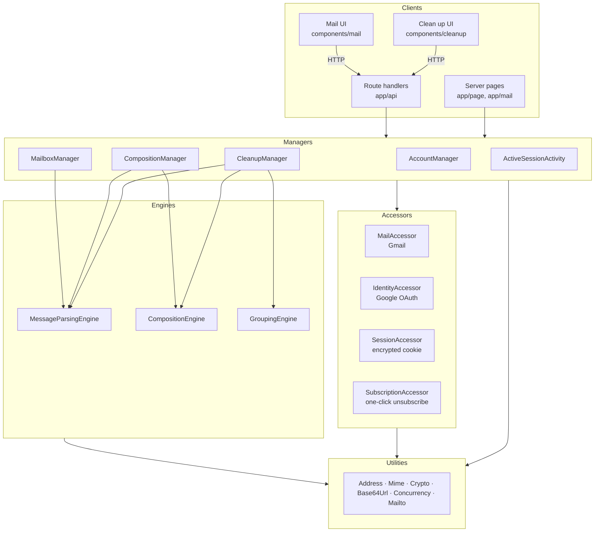
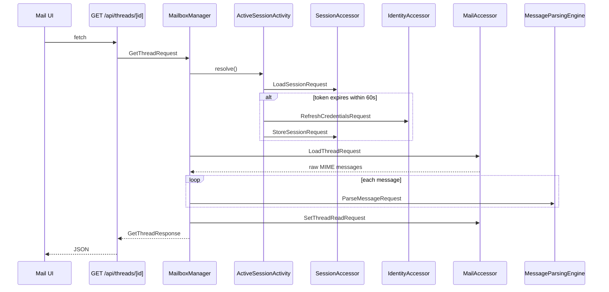
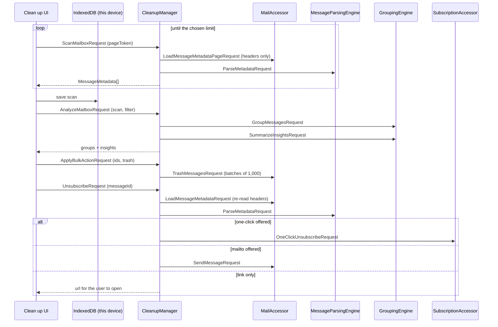
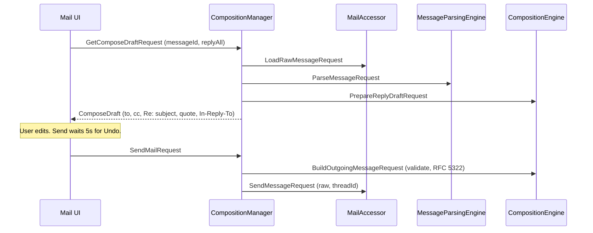

# RainSweep — Architecture

## Platform

**Progressive Web App** built with Next.js (App Router). Installable on desktop and mobile, opens recently read mail offline, shows an unread badge on the app icon, and can be the system handler for `mailto:` links.

---

## Technology Stack

Modeled on [LoreKeeper](https://github.com/Wintaru/LoreKeeper).

| Concern | Choice | Rationale |
|---|---|---|
| Framework | Next.js 16 (App Router) | Server route handlers hold the OAuth secret and talk to Gmail; React 19 client for the UI |
| Language | TypeScript (strict) | No `any`; type guards at every external boundary (Gmail JSON, Google tokens, cookies, request bodies) |
| Mail provider | Gmail REST API | Behind `MailAccessor`; the rest of the system is provider-neutral |
| Auth | Google OAuth 2.0, authorization code + PKCE | Behind `IdentityAccessor`; scope `gmail.modify` |
| Session | AES-256-GCM sealed, HttpOnly cookie | Behind `SessionAccessor`; no database needed to run |
| MIME parsing | `postal-mime` | Used only inside `MessageParsingEngine` |
| Styling | Tailwind CSS 4 | Light and dark themes from CSS variables |
| Testing | Vitest | Engines and utilities in isolation; managers through the real container with HTTP faked at the edge; an architecture test enforces the layer rules |
| Hosting | Vercel (or any Node host) | Zero-config for Next.js |

LoreKeeper uses Supabase for shared, real-time game state. A mail client's state lives in Gmail, so this project needs no database yet. Supabase slots in behind `SessionAccessor` (server-side sessions) or a new accessor (push subscriptions, settings) when a feature needs it, with no change to Managers.

---

## iDesign Decomposition

The system is decomposed by **volatility**, not by feature: each component encapsulates something likely to change, so that change stays local.

| Area of volatility | Encapsulated by | What could change |
|---|---|---|
| Mail provider | `MailAccessor` | Gmail → IMAP/SMTP, Microsoft Graph, JMAP |
| Identity provider | `IdentityAccessor` | Google → Microsoft, generic OIDC |
| Session storage | `SessionAccessor` | Encrypted cookie → Supabase/Redis sessions |
| Message format | `MessageParsingEngine` | MIME edge cases, inline images, S/MIME |
| Composition rules | `CompositionEngine` | Reply-all policy, quoting style, signatures, rich text |
| Grouping and insight rules | `GroupingEngine` | New groupings (by domain, by label), different size/age buckets, smarter subject matching |
| Unsubscribe transport | `SubscriptionAccessor` | RFC 8058 one-click → a third-party unsubscribe service |
| Use-case sequences | `AccountManager`, `MailboxManager`, `CompositionManager`, `CleanupManager` | New workflows (snooze, scheduled send, Auto Clean rules) |
| Presentation | Clients (`app/`, `components/`) | Layout, devices, shortcuts |

### Layer map



### Call rules

These are enforced by `tests/architecture.test.ts`, which fails the build on any violating import.

- Clients call **Managers only**. The browser reaches Managers through the route handlers over HTTP.
- Managers orchestrate Engines and Accessors. **Managers never call other Managers**; shared steps live in a manager-layer activity (`managers/shared/ActiveSessionActivity`).
- Engines hold business rules with no I/O. **Engines never call other Engines.**
- Accessors expose atomic business verbs (`ArchiveThread`, not `ModifyLabels`) over one resource. **Accessors never call other Accessors** and contain no business logic.
- Utilities are callable from every layer and call nothing above them.
- Only `MailAccessor` knows Gmail exists (also enforced by the architecture test). `SubscriptionAccessor` talks to the sender's unsubscribe endpoint, never to Gmail.

### Handler resolver pattern

Every component is a thin shell over one `HandlerResolver` per operation family (`query`/`execute` for Managers, `evaluate` for Engines, `load`/`store`/… for Accessors). All logic lives in `handlers/`. The `DependencyContainer` is the only place components are wired together.

One refinement over LoreKeeper: each request class names its response type (`class GetThreadRequest extends RequestBase<GetThreadResponse>`), so `manager.query(new GetThreadRequest(id))` returns `GetThreadResponse` with no cast, and the resolver keys on the request constructor itself rather than its name, which survives minification.

---

## Layer Responsibilities

### Managers

| Manager | Use cases |
|---|---|
| `AccountManager` | Begin sign-in (PKCE + state), complete sign-in, sign out (revoke + clear), get the signed-in account |
| `MailboxManager` | Labels with counts, thread pages and search, open a thread (parse + mark read), download an attachment, archive / move to inbox / trash / restore / read / unread / star / unstar, one at a time or for a selection |
| `CompositionManager` | Prepare a reply, reply-all or forward draft; send a message |
| `CleanupManager` | Scan a page of message metadata, group and summarize a scan, apply a bulk action (trash, restore, archive, move to inbox, read, unread) to up to 10,000 messages, unsubscribe from a sender |

`ActiveSessionActivity` is the manager-layer step every mailbox use case starts with: load the session and refresh the access token when it is about to expire.

### Engines

| Engine | Responsibility |
|---|---|
| `MessageParsingEngine` | RFC 5322/MIME → `MailMessage`; resolves `cid:` inline images to `data:` URIs; extracts attachments by index; headers → cleanup metadata, including `List-Id` and `List-Unsubscribe` |
| `CompositionEngine` | Who a reply goes to, reply-all recipients, `Re:`/`Fwd:` subjects, quoting, threading headers, recipient validation, and the outgoing message |
| `GroupingEngine` | Applies the size / age / unread filter, then groups the same messages by sender, mailing list, recurring subject, size bucket and age bucket, and summarizes inbox insights (top senders, never-opened subscriptions, largest senders, oldest mail) |

### Accessors

| Accessor | Resource | Verbs |
|---|---|---|
| `MailAccessor` | Gmail API | `load`: labels, thread page, thread (raw MIME), raw message, message metadata (single and paged). `store`: send, archive, move to inbox, trash, restore, set read, set starred, for threads and for message batches |
| `SubscriptionAccessor` | Sender unsubscribe endpoints | `unsubscribe`: RFC 8058 one-click POST |
| `IdentityAccessor` | Google OAuth 2.0 | `authorize`: build authorization URL, exchange code, refresh credentials. `revoke` |
| `SessionAccessor` | Encrypted cookies | `load` session; `store` session and pending sign-in; `remove` session and pending sign-in |

### Utilities

| Utility | Responsibility |
|---|---|
| `AddressUtility` | Parse, validate, format, dedupe email addresses |
| `MimeUtility` | Serialize an `OutgoingMessage` to RFC 5322 (encoded words, multipart, header-injection safe) |
| `CryptoUtility` | AES-GCM seal/unseal, random tokens, SHA-256 for PKCE, constant-time compare |
| `Base64UrlUtility` | Base64 and base64url encoding |
| `ConcurrencyUtility` | Bounded-parallel map, to stay inside Gmail's per-user quota |
| `MailtoUtility` | Parse `mailto:` URLs |

---

## Key flows

### Opening a conversation



### Cleaning up



The server stays stateless: the scan lives in the browser and is posted back for grouping, so changing a filter re-groups without re-reading Gmail. Trash uses the TRASH label, so every bulk action can be undone and nothing needs the broader `mail.google.com` scope.

### Replying



---

## Security model

- **OAuth**: authorization code flow with PKCE (S256) and a single-use `state` held in a sealed 10-minute cookie. The client secret never leaves the server.
- **Session**: `{account, credentials}` sealed with AES-256-GCM (`SESSION_SECRET`), HttpOnly, SameSite=Lax, Secure on HTTPS. Tampered cookies fail authentication and are treated as signed out.
- **CSRF**: state-changing routes reject cross-site requests (`Sec-Fetch-Site` / `Origin`).
- **Email HTML**: rendered in an `<iframe sandbox>` without `allow-scripts`; a CSP inside the frame blocks all remote loads (tracking pixels) until the reader clicks "Show images".
- **Attachments**: served with `Content-Disposition: attachment`, `nosniff`, and a sandboxing CSP.
- **Header injection**: `MimeUtility` strips CR/LF from every header value.
- **Offline cache**: mail cached by the service worker, and the Clean up scan in IndexedDB, stay on the device and are deleted on sign-out.
- **Unsubscribe**: the server re-reads `List-Unsubscribe` from Gmail instead of trusting the browser, so the endpoint can't be used to POST to arbitrary URLs. One-click requests go to https, public hostnames only, with no redirects followed, no credentials and a 10 s timeout.

---

## Folder structure

```
src/
├── app/                         # Client layer: pages and route handlers
│   ├── api/                     #   HTTP → Manager requests
│   ├── mail/page.tsx            #   the mail app (server checks session)
│   ├── cleanup/page.tsx         #   Clean up: groupings, insights, bulk actions
│   ├── page.tsx                 #   sign-in
│   └── manifest.ts              #   PWA manifest (shortcuts, mailto handler)
├── components/                  # Client layer: React UI
│   ├── mail/                    #   MailApp, ThreadList, ThreadView, ComposeDialog, …
│   ├── cleanup/                 #   CleanupApp, GroupTable, GroupDetail, InsightsOverview, scan cache
│   ├── pwa/
│   └── ui/
├── managers/
│   ├── account/                 # IAccountManager, AccountManager, Requests, Responses, handlers/
│   ├── mailbox/
│   ├── composition/
│   ├── cleanup/
│   └── shared/ActiveSessionActivity.ts
├── engines/
│   ├── messageParsing/
│   ├── composition/
│   └── grouping/
├── accessors/
│   ├── mail/                    # gmail/ holds the only Gmail-specific code
│   ├── identity/
│   ├── session/
│   └── subscription/
├── utilities/
├── common/                      # RequestBase, ResponseBase, resolver/
├── container/DependencyContainer.ts
├── lib/
│   ├── server/                  # request-scoped container, HTTP helpers
│   └── client/                  # browser API client, formatting
└── types/                       # provider-neutral domain model
public/sw.js                     # service worker
tests/                           # Vitest, including architecture.test.ts
```
