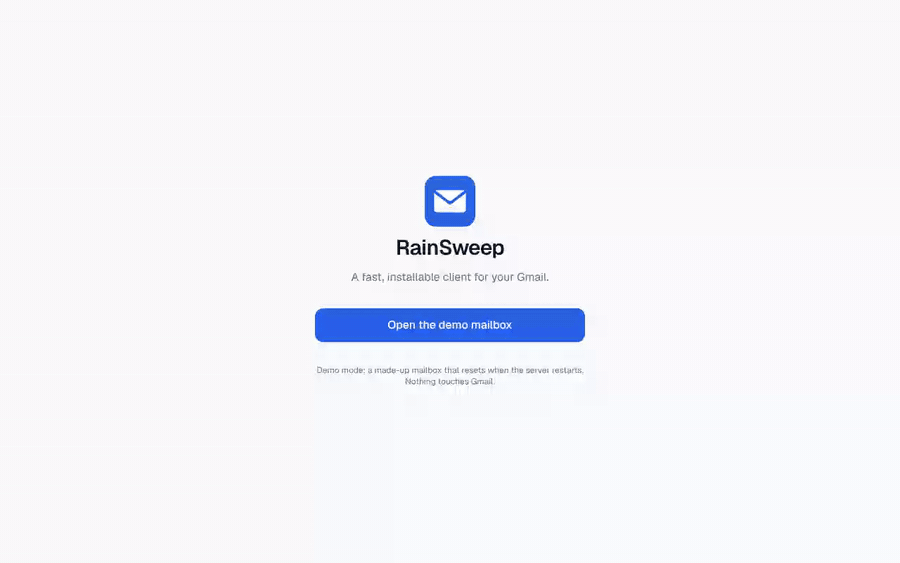
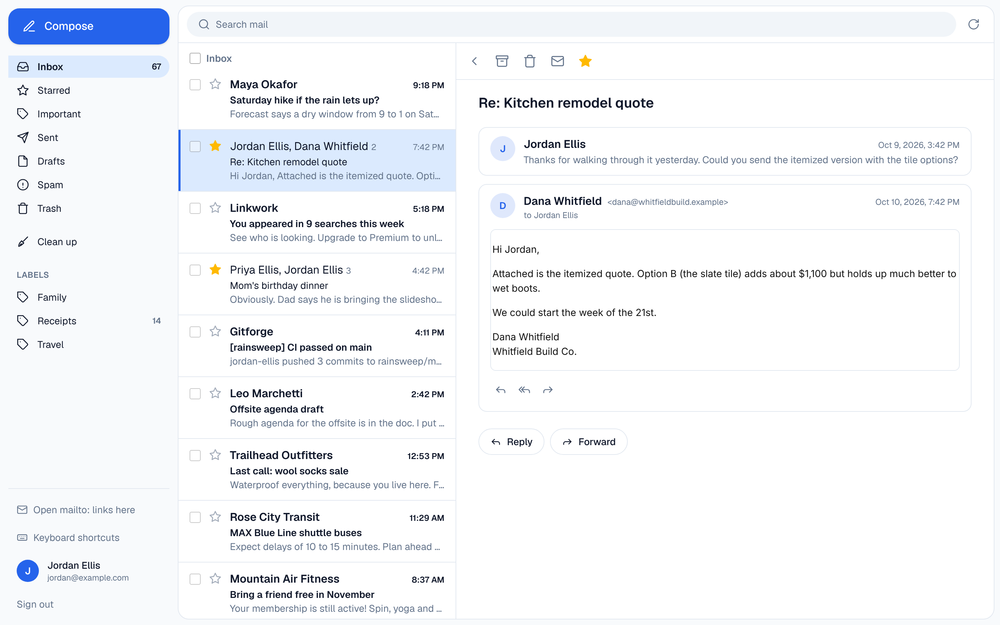
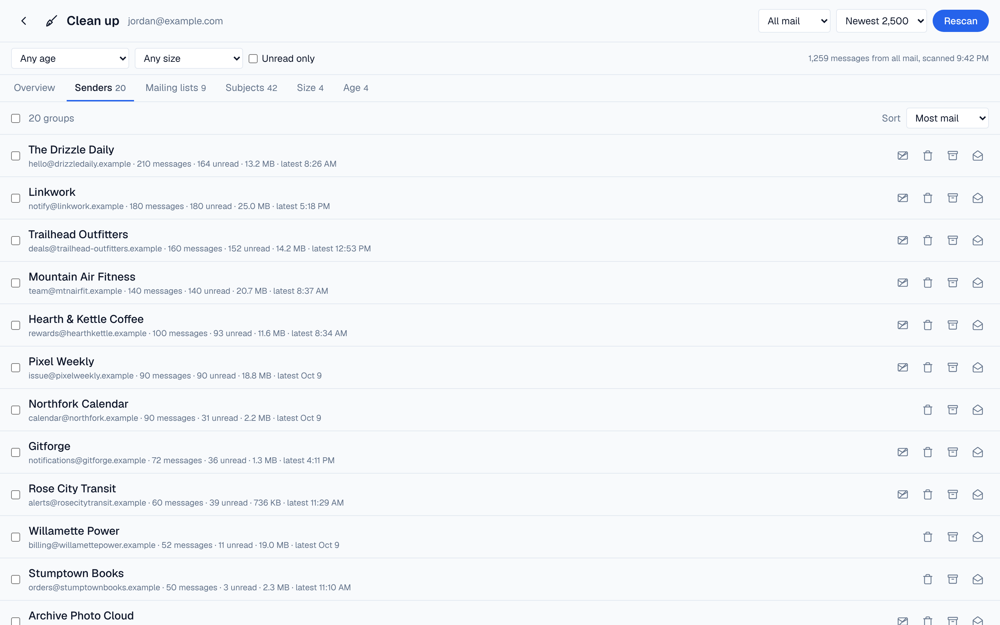
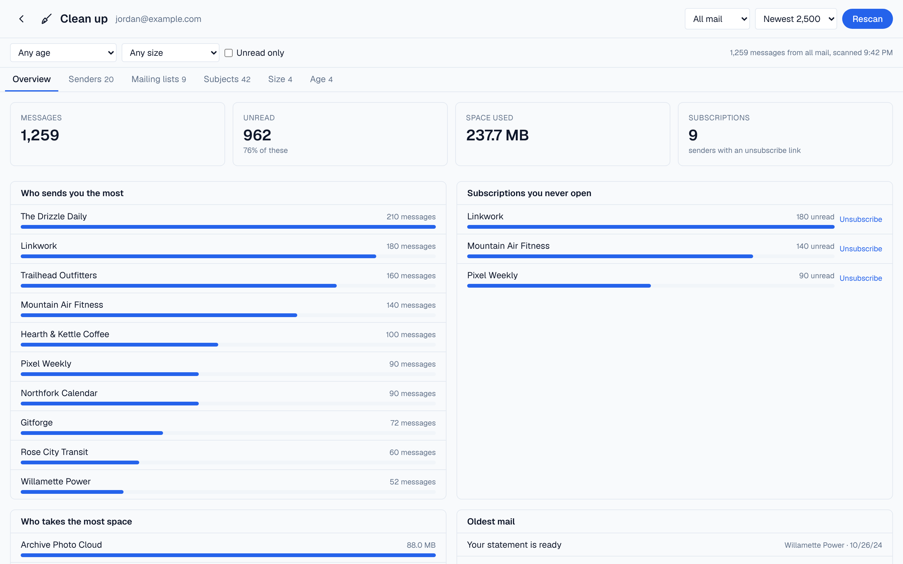
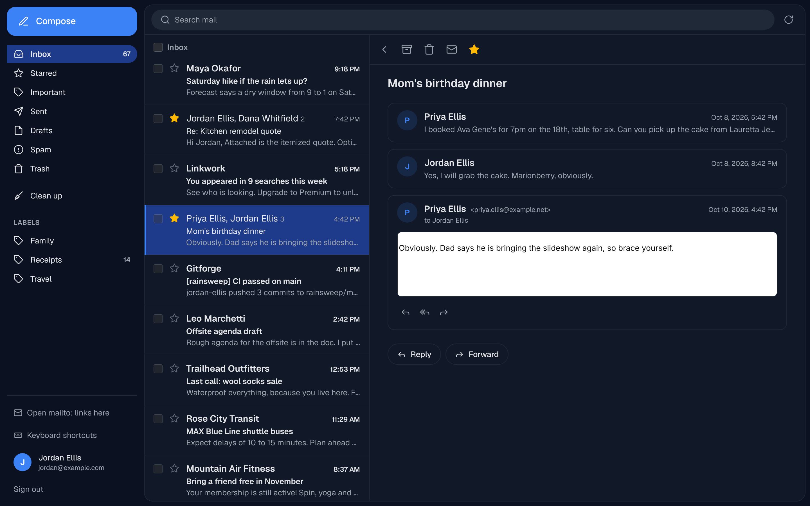
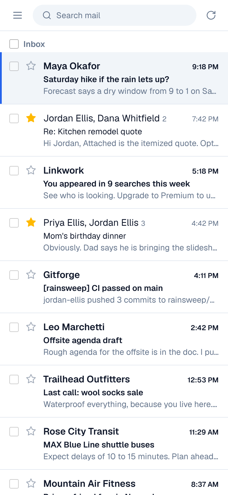

# RainSweep

A fast, installable Gmail client, and a working example of **iDesign** volatility-based decomposition in a modern Next.js app.



| Inbox and reading | Clean up, grouped by sender |
|---|---|
|  |  |
| **Inbox insights** | **Dark theme** |
|  |  |

<p align="center"></p>

<sub>Screenshots use the built-in demo mailbox. Every person, company and address in them is made up.</sub>

- Sign in with Google; read, search, archive, star, trash, reply, reply-all, forward and send (with attachments)
- **Clean up**: see who fills your mailbox, grouped by sender, mailing list, recurring subject, size and age. Unsubscribe in one click and trash, archive or mark read whole groups at once, with Undo
- Inbox insights: top senders, subscriptions you never open, who takes the most space, oldest mail
- Select several conversations and act on them together
- Gmail-style keyboard shortcuts (`?` shows them), Undo for archive, delete and send
- Installable PWA: offline reading of recently opened mail, unread badge on the app icon, opens `mailto:` links, new-mail notifications
- Email HTML is sandboxed and remote images (tracking pixels) are blocked until you ask for them
- Light and dark themes; works on phones

The stack and conventions follow [LoreKeeper](https://github.com/Wintaru/LoreKeeper). [ARCHITECTURE.md](ARCHITECTURE.md) explains the decomposition.

## Try it without a Google account

Demo mode runs the whole app against a made-up mailbox of about 1,250 messages. Nothing touches Gmail, and you don't need a Google Cloud project or `.env.local`.

```bash
npm install
npm run demo
```

Open http://localhost:3000 and click **Open the demo mailbox**. Archive, trash, send, scan and unsubscribe all work; the mailbox resets when the server restarts. Only the network edge is faked (`src/lib/server/demo/` stands in for Google's HTTP APIs), so every Manager, Engine and Accessor runs exactly as it does against real Gmail.

To refresh the screenshots above after a UI change:

```bash
npm run build:demo && npm run start:demo   # terminal 1
npm run screenshots                         # terminal 2 (needs ffmpeg for the GIF)
```

## Run it locally

You need Node 20+ and a Google Cloud OAuth client.

### 1. Create Google OAuth credentials

1. In the [Google Cloud console](https://console.cloud.google.com/), create a project (or pick one).
2. **APIs & Services → Library**: enable the **Gmail API**.
3. **APIs & Services → OAuth consent screen**: choose *External*, fill in the app name and your email, and add yourself under **Test users**. While the app is in testing, only test users can sign in.
4. Add the scope `https://www.googleapis.com/auth/gmail.modify` (plus `openid`, `email`, `profile`).
5. **APIs & Services → Credentials → Create credentials → OAuth client ID**, type *Web application*.
   - Authorized redirect URI: `http://localhost:3000/api/auth/google/callback`
   - Add your production URL's `/api/auth/google/callback` too when you deploy.

### 2. Configure

```bash
cp .env.example .env.local
node -e "console.log(require('crypto').randomBytes(32).toString('base64'))"   # paste as SESSION_SECRET
```

Fill in `GOOGLE_CLIENT_ID`, `GOOGLE_CLIENT_SECRET` and `SESSION_SECRET` in `.env.local`. Never commit that file.

### 3. Start

```bash
npm install
npm run dev
```

Open http://localhost:3000 and sign in.

## Scripts

| Command | What it does |
|---|---|
| `npm run dev` | Development server |
| `npm run demo` | Development server with the demo mailbox, no Google account needed |
| `npm run screenshots` | Regenerate `docs/screenshots/` from a running demo server |
| `npm run build` / `npm start` | Production build and server (the service worker only registers in production) |
| `npm test` | Unit, integration and architecture tests (Vitest) |
| `npm run lint` | ESLint |
| `npm run typecheck` | TypeScript, no emit |

## Deploying to Vercel

Import the repo, set the four variables from `.env.example` (with `APP_URL` set to your deployment URL), and add `${APP_URL}/api/auth/google/callback` as a redirect URI on the OAuth client. Vercel caps request bodies at 4.5 MB, so the composer limits attachments to 4 MB in total.

## How the code is organized

```
Clients (app/, components/) ──▶ Managers ──▶ Engines ──▶ Accessors ──▶ Gmail / Google / cookies
                                    └─────────────────────▲
                            Utilities are available to every layer
```

`tests/architecture.test.ts` fails if any import breaks these rules. See [ARCHITECTURE.md](ARCHITECTURE.md) for the full map and [CLAUDE.md](CLAUDE.md) for contributor conventions.
